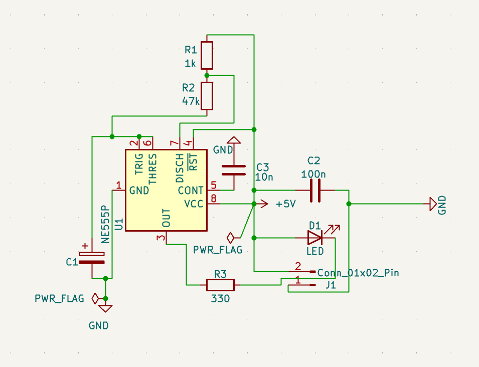
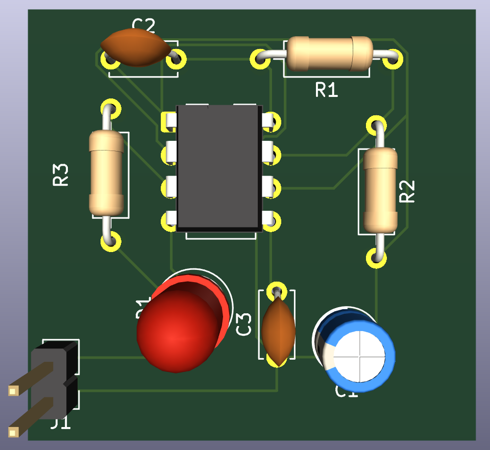
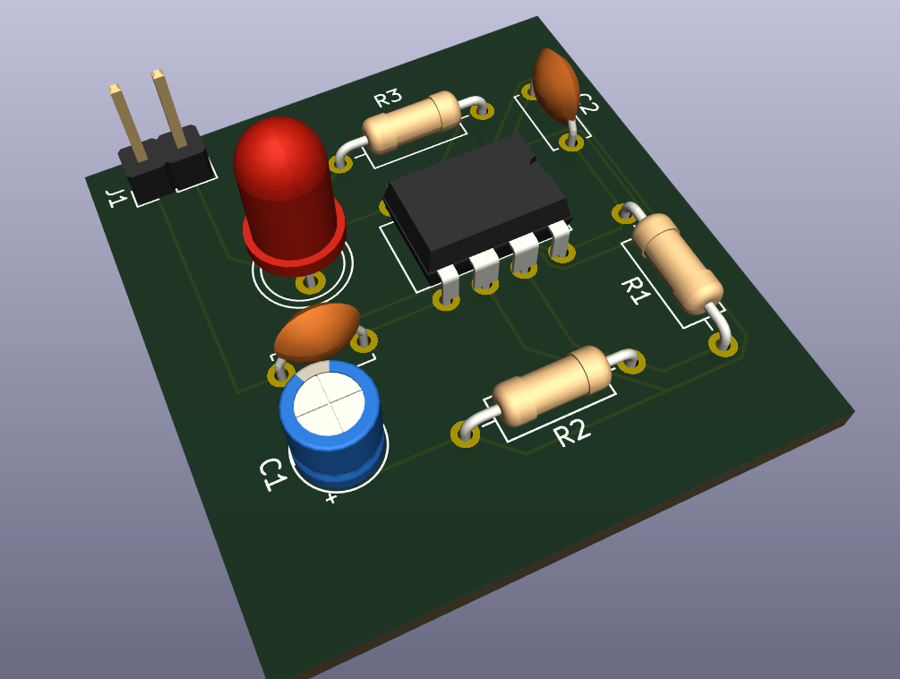

# ⚡ NE555 Timer — Blinking LED Circuit

<p align="center">
  <strong>One IC. One LED. Endless possibilities to learn.</strong>
</p>

<p align="center">
  
  
  
</p>

---

## 🔍 About The Project

This project is a **blinking LED circuit based on the NE555 timer IC**, designed using KiCad.

The NE555 operates as an astable multivibrator, continuously generating pulses that turn the LED on and off at regular intervals.

The purpose of this project is to gain practical experience in electronic circuit design, schematic development, PCB layout, and hardware design fundamentals.

## 📸 Project Gallery

### Circuit Schematic



### PCB Layout



### 3D PCB Visualization



---

## 🧩 Components

| Component | Function |
|---|---|
| NE555 Timer IC | Generates periodic pulses |
| Resistors | Control timing and LED current |
| Capacitor | Determines timing characteristics |
| LED | Visual output indicator |
| Power Supply | Provides operating voltage |

## ⚙️ How It Works

The NE555 is configured in astable mode.

1. The capacitor charges through the resistor network.
2. When the capacitor voltage reaches the upper threshold, the output changes state.
3. The capacitor discharges through the discharge path.
4. When the voltage reaches the lower threshold, the output changes again.
5. This cycle repeats continuously, causing the LED to blink.

The blinking frequency depends on the resistor and capacitor values.

## 🛠️ Design Tools

- **KiCad** — Schematic capture and PCB design
- **Gerber** — PCB manufacturing file format

## 📂 Repository Structure

```text
555-timer-led-circuit/
│
├── README.md
├── images/
│   ├── schematic.png
│   ├── pcb-layout.png
│   └── 3d-view.png
│
├── gerber/
│
├── 555_timer_devre.kicad_pro
├── 555_timer_devre.kicad_sch
└── 555_timer_devre.kicad_pcb
```

## ✅ Project Progress

- [x] Circuit schematic design
- [x] Component selection
- [x] PCB layout
- [x] Gerber file preparation
- [ ] Physical PCB production
- [ ] Hardware testing

## 📚 What I Learned

- Understanding the NE555 timer IC.
- Learning the astable multivibrator configuration.
- Creating electronic schematics with KiCad.
- Component placement and PCB routing.
- Preparing PCB manufacturing files.

## 🚀 Future Improvements

- Measure the actual LED blinking frequency.
- Compare theoretical and measured timing values.
- Improve PCB layout and component placement.
- Experiment with different resistor and capacitor values.
- Build more advanced timer-based circuits.

---

## 👨‍💻 About Me

I am an Electrical and Electronics Engineering student interested in electronics, PCB design, embedded systems, and hardware development.

This repository is part of my practical learning journey, where I document my projects, experiments, and progress in electronics engineering.

<p align="center">
  <strong>Learn. Design. Build. Repeat.</strong>
</p>
